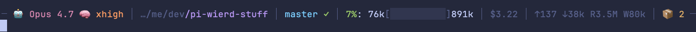

# @wierdbytes/pi-statusline

Minimal Tokyo Night Storm statusline for [pi](https://github.com/earendil-works/pi).
Renders a compact one-line status row above the editor, with the editor's
own top/bottom borders stripped so the two visually merge into a single
cluster.



Sections (each appears only when relevant; ordering and visibility are
fully configurable — see [Layout](#layout) below):

- **Model** — the active model's display name (e.g. `Opus 4.7`), no icon prefix.
  `Claude ` and `anthropic/` prefixes are stripped for brevity. The
  optional **thinking** segment (`@` + level, e.g. `Opus 4.7 @high`) renders inline after
  the model name when the active model is reasoning-capable and the
  `Model: show thinking` sub-toggle is on. Thinking is a sub-segment
  of the model block — they always render together and reorder as one
  unit (mirrors how the hit-rate and savings segments live inside the
  cache block).
- **Path** — up to the last three segments of `cwd` with a `…/` prefix.
  Parent segments in gray, current directory in purple.
- **Git** — clean/dirty marker (`✓` green / `✗` red) followed by the
  branch name, e.g. `✗ master`.
  Hidden when not in a git repo.
- **Context** — current context-window usage reported by pi, printed as
  `pct%: used[▓░░░]remaining` against the model's full context window with a
  colored progress bar. Color shifts green → yellow → red as you approach
  the limit. While usage is temporarily unknown immediately after compaction,
  the block shows `?` markers instead of stale pre-compaction values.
- **Cost** — session total in USD when greater than zero.
- **Cache** — prompt-cache efficiency for the current session branch,
  e.g. ` 99.9% (200k/200) -$0.86 󰔟 4:21` (icons are shown with the
  Nerd Font icon set only). Four segments, each with its own sub-toggle;
  their order is configurable too (see [Layout](#layout)):
  - **Hit rate** — `cacheRead / (input + cacheRead + cacheWrite)`,
    green at ≥ 98.0%, yellow from 90.0% to 97.9%, red below 90.0%.
  - **Tokens** — `(200k/200)`: tokens served from cache vs. tokens
    that were not (`input + cacheWrite`).
  - **Savings** — what prompt caching saved (gray `-$0.86`) or cost
    extra (red `+$0.15`) compared to sending the same prompts without
    caching. Per assistant message:
    `Δ = (cost.input + cost.cacheRead + cost.cacheWrite) − (input + cacheRead + cacheWrite) × inputPrice`.
    The actual side is pi's own billing, so 5m vs 1h cache writes
    (`usage.cacheWrite1h`, billed at 2× input) and pricing tiers are
    already accounted for; output tokens cancel out. The input price
    is taken from the message (`cost.input / input`), falling back to
    the model registry when a message has no uncached input.
    pi's cache-warming requests (`cache_warm` usage entries) exist only
    because of caching, so their full cost is added to Δ as overhead;
    they don't count towards the hit rate.
  - **Expiry timer** — countdown until the provider evicts the prompt
    cache (`m:ss`, ticks every second): gray above 0:30, yellow up to
    0:30, red `0:00` once expired (the hourglass empties). The lifetime
    restarts on every request that reads or writes the cache — real
    requests (from the moment they are sent, not when they finish) and
    pi's cache warming refreshes. Lifetime comes from the model's
    `promptCache` tiers: the long tier when the request reported 1h
    cache writes or `PI_CACHE_RETENTION=long`, the short tier otherwise.
    While `/warmer` is on, the timer is followed by `` (`*` in the
    other icon sets), e.g. `󰔟 4:52 `.

  Hidden until the provider has read from or written to the cache.
- **Stash** — `📦 N` showing how many prompts are saved in the stash history
  (see below). Hidden when empty.
- **Subagents** — `🤖 agents N/M` chip when [`@tintinweb/pi-subagents`](https://github.com/tintinweb/pi-subagents)
  is loaded and at least one agent is active. `N` is the number currently
  running, `M = N + queued`. The chip clears as soon as every agent
  reaches a terminal state. Failures and long-running completions surface
  as one-shot toasts above the row — see [Subagents bridge](#subagents-bridge).

Inspired by [`pi-powerline-footer`](https://github.com/nicobailon/pi-powerline-footer)
by [@nicobailon](https://github.com/nicobailon) — the original brought the
statusline-as-footer idea to pi. This extension is a from-scratch take that
focuses on just that footer (skipping the bash mode, working vibes, and
welcome overlay pieces).

## Narrow terminals

Below 60 columns the statusline wraps onto a second row when the blocks
don't fit on one: the first row takes as many whole blocks as fit, the
rest go to the second row, and the path block shrinks to the current
directory (`…/pi-wierd-stuff`). Never more than two rows — a row that
still overflows is truncated. At 60 columns and wider it always stays
on one row (truncated when it overflows).

## Layout

The statusline ships with eight reorderable blocks: `model`, `path`,
`git`, `context`, `cost`, `cache`, `chips`, and `stash`. Each can be
reordered or hidden via the **Layout** tab in the settings overlay (`/statusline`),
or through the imperative `/statusline layout ...` subcommands.

The **Layout** tab lists each block as its own row, in the current
order. The right-hand value cell is a checkbox: `[✓]` when the block
is visible, `[ ]` when hidden. Enabled rows render in the active text
color; disabled rows fade to gray.

Direct Layout-tab key bindings:

- `space` — toggle the focused block's visibility.
- `alt+↑` / `alt+↓` — swap the focused block with its neighbour.
  Focus follows the moved row, persistence is immediate, and the
  separator field at the bottom is non-reorderable so it doesn't get
  in the way.
- `enter` — open the block's sub-menu **only if the block has
  block-specific knobs** (currently `model` and `cache`). For every
  other block (`path`, `git`, `context`, `cost`, `chips`, `stash`)
  Enter is a no-op and the footer hint doesn't advertise it.

Sub-menu contents (Enter on the row):

- (`model`) **Show thinking level** — inline thinking segment after
  the model name. Only renders for reasoning-capable models anyway.
- (`cache`) **Show hit rate / Show tokens / Show savings / Show expiry timer** —
  individual sub-toggles for the four segments inside the cache block,
  listed in display order. `alt+↑` / `alt+↓` moves the focused segment
  (focus follows it). The cache icon stays in front of the hit rate;
  when the hit rate is hidden it leads the block in gray.

Block visibility lives on the Layout tab (`space`), not inside the
sub-menu; block reorder lives on the Layout tab (`alt+↑↓`) — the
sub-menu's own `alt+↑↓` only reorders segments within the block.
This keeps the sub-menu tightly scoped to settings that **only** make
sense for one specific block.

At the bottom of the Layout tab:

- **Separator** — glyph rendered between visible blocks. Built-in
  choices: `│` (default), `·`, `▎`, `:`, `(space)`. Hand-edit
  `~/.pi/agent/wierd-statusline/events.json` for anything else (the
  loader clamps to 1–2 visible columns; newlines/tabs are stripped).

Imperative shortcuts — same persistence bus the modal uses:

- `/statusline layout` — print the active order, e.g.
  `model > path > git! > context > cost > cache > chips > stash (7/8 visible)`
  (a trailing `!` marks a disabled block).
- `/statusline layout reset` — restore defaults.
- `/statusline layout toggle <block>` — flip one block's visibility.
- `/statusline layout move <block> <up|down|top|bottom>` — reorder.

The layout slice is persisted alongside the other knobs in
`~/.pi/agent/wierd-statusline/events.json` (schema `version: 2`).
Upgrading from a `version: 1` file is transparent: the missing layout
slice is injected with defaults and the file is rewritten on first
load, so users coming from `0.6.x` see no visible change. Since
`0.8.0` the old `tokens` counter block is replaced by `cache`: a
persisted `tokens` entry keeps its slot and visibility but renders the
cache block instead (the old per-counter sub-toggles are dropped).

## Editor stash

Press `Alt+S` to save the editor's contents and clear the input, type a quick
prompt, and the stashed text auto-restores when the agent finishes — but only
if the editor is empty at that point (otherwise the stash is preserved and a
notification reminds you to clear and `Alt+S` to restore). Pressing `Alt+S`
again with text in the editor *updates* the live stash slot. The statusline's
`📦 N` indicator reflects the current stash-history depth.

Every stash is pushed onto a persisted MRU history (12 entries max, stored at
`~/.pi/agent/wierd-statusline/stash-history.json`). Press `Ctrl+Alt+S` to
open a picker overlay; navigate with arrows, `Enter` inserts the selected
entry (replace/append/cancel prompt if the editor is non-empty), `d` deletes
the selected entry, and `Esc` cancels.

## Install

```bash
pi install npm:@wierdbytes/pi-statusline
```

Restart pi to activate.

## Commands

- `/statusline on` — enable the statusline
- `/statusline off` — disable, restoring pi's default editor and footer
- `/statusline toggle` — toggle
- `/statusline footer on|off|toggle` — show/hide pi's built-in footer beneath the editor (hidden by default)
- `/statusline events [status|log|clear|toast-ms <level> <ms>]` — inspect / tune the chip+toast pipeline
- `/statusline icons [nerd-font|plain|ascii|minimal|emoji|status]` — switch the icon set used for stash / toast levels / subagents chip
- `/statusline layout [status|reset|toggle <block>|move <block> <up|down|top|bottom>]` — configure block order + visibility (see [Layout](#layout))
- `/warmer` — toggle forced prompt-cache warming for the current session (off by default, resets on new / resumed / forked sessions). While on, pi's cache-warming decisions are overridden: a refresh is sent whenever the avoided cache miss exceeds the refresh cost by at least $0.01, ignoring pi's idle continuation estimate (15%) and its $0.05 threshold. pi's own limits still apply: the model needs a known cache lifetime, idle warming needs `cacheWarming: "idle"` in pi settings, and warming stops after 30 minutes idle / 60 minutes of an active run.
- `/statusline subagents [status|on|off|long-ms <ms>|toast-failure <on|off>|toast-long <on|off>|toast-scheduled <on|off>]` — control the subagents bridge (see below)

## Icon sets

The statusline ships five built-in icon sets you can swap with
`/statusline icons <set>` (or via the **Icon set** field on the
Display tab of the settings overlay). The choice persists in
`~/.pi/agent/wierd-statusline/events.json`.

| Set | Sample row | Notes |
|---|---|---|
| `nerd-font` (default) | `sonnet-4.5 @med │ … │ ✓ master │ 45%: … │ $0.12 │  2` | Nerd Font glyphs (PUA codepoints). Requires a Nerd Font configured in your terminal. |
| `plain` | `sonnet-4.5 @med │ … │ ✓ master │ 45%: … │ $0.12 │ ▤ 2` | Geometric Unicode glyphs that ship with every modern font. No install required. |
| `ascii` | `sonnet-4.5 @med \| … \| ✓ master \| 45%: … \| $0.12 \| [s] 2` | Bracketed ASCII labels. Survives broken fontconfig, ssh sessions, and log files. |
| `minimal` | `sonnet-4.5 @med │ … │ ✓ master │ 45%: … │ $0.12 │ ≡ 2` | Single-character symbolic glyphs. Powerline / starship aesthetic. |
| `emoji` | `sonnet-4.5 @med │ … │ ✓ master │ 45%: … │ $0.12 │ 📦 2` | Original pre-facelift look. Kept for users who prefer emoji. |

`git` (✓ / ✗) and the inline subagent completion / failure marks
(✓ / ✗) intentionally stay plain Unicode regardless of the active
set — they look identical everywhere and read as state, not
decoration.

## Subagents bridge

When [`@tintinweb/pi-subagents`](https://github.com/tintinweb/pi-subagents)
is installed alongside this extension, the statusline subscribes to the
`subagents:*` lifecycle events on `pi.events` and renders an aggregated
`agents N/M` chip in the chips segment whenever at least one agent is
active (the chip's icon follows the active icon set). The bridge runs
entirely on the statusline side — no changes are required in
pi-subagents itself, and the existing `🔴 Agents …` widget above the
editor keeps rendering its rich tree.

Defaults:

| Behaviour | Default |
|---|---|
| Show summary chip while agents are running | on |
| Toast on failure / abort / stop | on (error level, sticky until dismissed) |
| Toast on completions ≥ 30 s | on (success level) |
| Toast on `subagents:scheduled` | off |
| Long-completion threshold | 30 000 ms |

Tune via `/statusline subagents …`. Settings persist in
`~/.pi/agent/wierd-statusline/events.json` next to the toast-timeout map.
`/statusline subagents status` prints the live counts plus the current
config.

## Console output

While the TUI is running, anything extensions print with `console.*` or
write to stderr is kept off the screen — text written behind pi-tui's
back shifts the screen and leaves duplicated rows. It goes to
`~/.pi/agent/wierd-statusline/console.log` instead (rotated to
`console.log.1` past 1 MB); `console.warn` / `console.error` also show
as a toast. Once pi exits or crashes, output reaches the terminal as
usual.

## Shortcuts

- `Alt+S` — stash editor text / restore stash when editor is empty
- `Ctrl+Alt+S` — open the stash history picker
